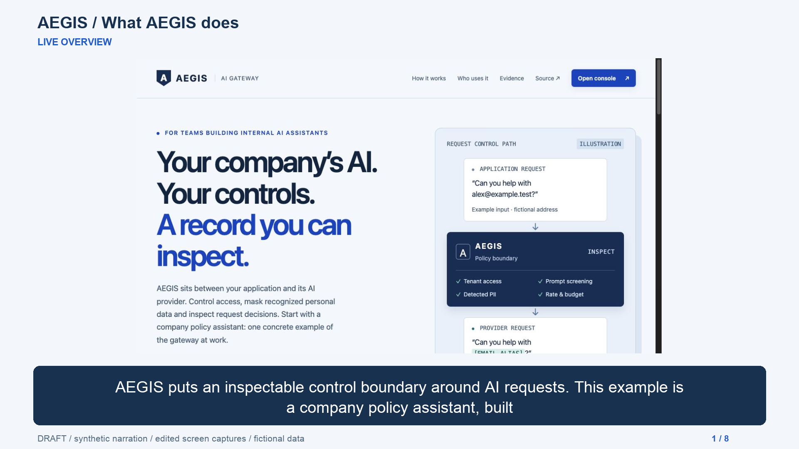
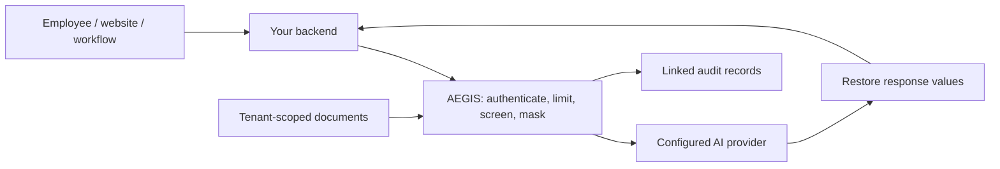

# AEGIS — an inspectable gateway for AI applications

**Put tenant access, request screening, recognized-PII masking and audit records
between your application's backend and its AI provider.**

[](https://github.com/dgexplores/aegis-gateway/actions/workflows/ci.yml)

[Live showcase](https://aegis-gateway-free.onrender.com/showcase) ·
[Try the console](https://aegis-gateway-free.onrender.com/dashboard) ·
[API docs](https://aegis-gateway-free.onrender.com/docs) ·
[Engineering case study](docs/RECRUITER-CASE-STUDY.md) ·
[Watch the walkthrough](#watch-the-walkthrough)

## Watch the walkthrough

[](https://aegis-gateway-free.onrender.com/static/walkthrough/index.html)

**[Play the 2:21 walkthrough](https://aegis-gateway-free.onrender.com/static/walkthrough/index.html)** ·
[Download MP4](https://aegis-gateway-free.onrender.com/static/walkthrough/aegis-walkthrough.mp4) ·
[Captions (SRT)](src/aegis/static/walkthrough/aegis-walkthrough.srt) ·
[Script and storyboard](docs/VIDEO-WALKTHROUGH.md)

An edited draft using actual product captures, fictional data and synthetic
narration. It covers the company-policy use case, privacy masking, refused
requests, engineering evidence and backend integration. The public demo uses
deterministic echo output; the walkthrough does not establish real-model answer
quality.

## What is it for?

A development or IT team is adding an internal AI assistant to a website, portal
or workflow. The application needs to identify callers, limit usage, handle
sensitive input, manage provider failures and explain request decisions.
AEGIS exposes those controls through one Python/FastAPI service.

**The example use case is a company policy assistant.** An employee asks about
leave or expenses. The company's backend sends the question to AEGIS, which
retrieves tenant-scoped policy context, screens and masks the messages, calls a
configured provider and records supported decisions. The console makes the
response and available evidence inspectable.

The gateway is the product. The fictional Northstar policy assistant is the
example application. AEGIS does not train or host a language model.



## Try it in two minutes

1. Open the [console](https://aegis-gateway-free.onrender.com/dashboard).
2. Select **Vacation days** and inspect the retrieved source and provider label.
3. Select **Try privacy check**, then **Show details** to inspect the sanitized
   outbound message containing an alias for the fictional email.
4. Select **Try attack attempt** and inspect the refusal.
5. Open the [engineering showcase](https://aegis-gateway-free.onrender.com/showcase)
   for recorded payload, poisoned-document, failover and audit-tampering experiments.

**Public demo mode:** echo produces deterministic test output, not AI-generated
policy answers. The published demo key is public; use fictional data. Free hosting
can sleep and reset local state. Missing fictional policies reload at startup.

## Run a prepared local showcase

Requires Python 3.11 or newer. No external model, Redis or Postgres is needed
for the offline showcase.

```bash
git clone https://github.com/dgexplores/aegis-gateway.git
cd aegis-gateway
python3 -m venv .venv
source .venv/bin/activate
pip install -e '.[dev]'
python scripts/showcase.py
```

Open the printed URL. The launcher generates a temporary credential and seeds
fictional policies in an isolated instance. It leaves your existing `.env` and
corpus alone. Stop it with Ctrl+C; temporary state is removed.

```bash
# Exercise retrieval, masking, refusal and actual provider identity over HTTP.
python scripts/showcase.py --check --report work/showcase-echo.json

# After securely exporting OPENAI_API_KEY, use an external provider.
python scripts/showcase.py --provider openai
```

The launcher also supports `--provider anthropic` and `--provider gmi`, using
the corresponding exported provider key. A configured provider can fail over
to echo: inspect the actual response provider. Real-model verification needs
`--provider openai --check` (or another selected provider) plus manual review
of the answer against its source. [Full setup and presenter guide](docs/SHOWCASE.md).

## Connect a website or workflow

Call AEGIS from your backend or a server-side HTTP workflow step. Keep scoped
AEGIS credentials and provider credentials out of browser code.

```bash
# AEGIS_BASE_URL and AEGIS_API_KEY refer to your own configured deployment.
curl --fail-with-body "$AEGIS_BASE_URL/v1/chat" \
  -H "Authorization: Bearer $AEGIS_API_KEY" \
  -H "Content-Type: application/json" \
  -d '{"messages":[{"role":"user","content":"Explain our leave policy."}]}'
```

`/v1/chat` does not retrieve documents. For a document assistant, ingest approved
policy text through `/v1/rag/ingest` and ask through `/v1/rag/query`.

| Application need | Endpoint | Required scope |
|---|---|---|
| Chat request and decision metadata | `POST /v1/chat` | `chat` |
| OpenAI-style non-streaming response envelope | `POST /v1/chat/completions` | `chat` |
| Native streaming chat | `POST /v1/chat/stream` | `chat` |
| Ingest or query tenant documents | `POST /v1/rag/ingest`, `POST /v1/rag/query` | `rag` |
| List tenant documents | `GET /v1/rag/documents` | `rag` |
| Operator controls and cross-tenant audit review | `/admin/*` | Appropriately scoped operator access |

OpenAI-style compatibility is limited: the `model` field does not select a
provider/model in this endpoint; server-side routing does. Its `stream=true`
option is rejected. [Working server-side examples and response handling](docs/INTEGRATION.md).

## What the engineering demonstrates

- One pipeline screens and redacts every message role, including retrieved context.
- Tenant-scoped retrieval, caches and reversible alias maps separate service state.
- Provider contracts, fallback handling, usage limits and operator controls are explicit.
- HMAC-signed linked audit records support verification of retained evidence.
- CI runs lint/type checks, a Python-version test matrix, dependency/secret checks,
  evaluation gates, integration checks and Docker validation.
- Delivery tooling builds container images. The public Render evaluation service
  deploys from `main`; the Kubernetes workflow renders deployment manifests and
  can run a configured staging smoke test. It does not itself apply those manifests
  to a company cluster.

Reproduce the experiments and verification:

```bash
make recruiter-evidence   # HTML + JSON; real pipeline with recording/failing providers
make verify              # full local verification gates
```

The last recorded suite completed with **533 passed, 5 skipped**. The skipped
checks require a live provider. Seven evidence fixtures inspect downstream
payloads, refusal side effects, poisoned retrieval, tenant state, failover and an
altered audit copy. These are scoped experiments, not a security or model-quality
score. [Current evidence and limits](STATUS.md).

## Readiness and important limits

| Ready to demonstrate | Requires deployment-specific verification |
|---|---|
| Public controls demo and recorded engineering evidence | Real-model answer quality, latency, availability and cost |
| HTTP APIs for a developer-led integration pilot | Company identity integration, private credentials and approved corpus |
| Docker, Compose, Render and Kubernetes configurations | Persistent storage, backup/restore, workload limits and operational ownership |

Pattern screening and PII recognition can miss inputs or refuse benign ones.
A retained HMAC-linked chain does not prove complete history, public-key
non-repudiation or compliance. Multi-replica state and audit reconciliation need
separate evaluation. The public demo is not a company production deployment.

[Production-readiness plan](docs/PRODUCTION-READINESS.md) ·
[Operations runbook](docs/RUNBOOK.md) · [Architecture](docs/ARCHITECTURE.md) ·
[Roadmap](ROADMAP.md) · [Security reporting](SECURITY.md)

## Repository map

| Location | Purpose |
|---|---|
| `src/aegis/api/`, `gateway.py` | HTTP boundary and request orchestration |
| `src/aegis/security/` | Authentication, screening, masking and audit verification |
| `src/aegis/providers/`, `rag/` | Provider contracts and tenant-scoped retrieval |
| `tests/`, `scripts/` | Regression tests, evidence runners and operational drills |
| `deploy/`, `render*.yaml`, `docker-compose.yml` | Deployment configurations |
| `docs/` | Integration, case study, walkthrough and design decisions |
| `docs/archive/` | Historical review; not a current assessment |

## Ownership and contribution

Portfolio owner: **Deepak Gangwar**. Developed and refined with AI assistance.
Contributions should be described through source history, reproducible checks and
implementation decisions the presenter can explain. MIT licensed; see [LICENSE](LICENSE).

See [CONTRIBUTING.md](CONTRIBUTING.md) for local checks and contribution guidance.
