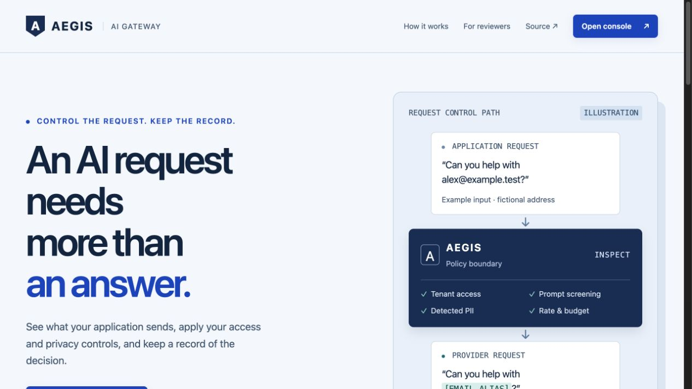
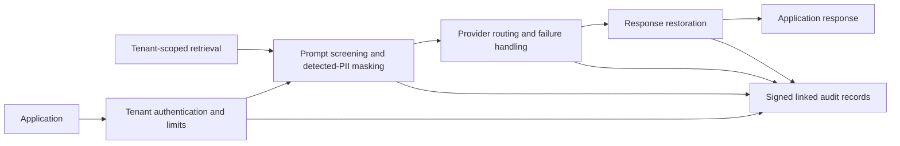

# AEGIS — controls for internal AI assistants

**A Python/FastAPI gateway for request screening, detected-PII masking, tenant
controls, provider routing and verifiable audit records.**

AEGIS puts an inspectable policy boundary between an application and its AI
providers. It authenticates the caller, checks limits, screens supported prompt
patterns, masks recognized personal data, calls a configured provider and records
the decision. The browser console exposes the response alongside its evidence.

[Open the public demo](https://aegis-gateway-free.onrender.com/) ·
[Request console](https://aegis-gateway-free.onrender.com/dashboard) ·
[API documentation](https://aegis-gateway-free.onrender.com/docs) ·
[Source](https://github.com/dgexplores/aegis-gateway)

**Demo boundary:** the default `echo` provider is deterministic. It demonstrates
request handling and gateway controls, not LLM answer quality. The public demo
key is intentionally public: use fictional data only. Free hosting can sleep
and its local state can reset. Real providers require credentials and separate
verification; a working echo demonstration does not establish a successful
external model integration.



## For recruiters and technical reviewers

Start with the **[engineering case study](docs/RECRUITER-CASE-STUDY.md)**:
inspect actual provider payloads, refuse a poisoned retrieved document, inject a
provider failure, and alter an audit-log copy to see verification fail.

```bash
make recruiter-evidence
```

This generates a readable report and JSON observations from the real gateway,
retrieval and audit code with recording/failing test providers. Seven fixture
checks run without a model API. The evidence target also runs in `make verify`.
It demonstrates control behaviour; real-model quality is a separate evaluation.

## Start with one use case: a company policy assistant

**For developers and IT teams building internal AI assistants.** Employees ask
about fictional company policies; the team inspects access decisions, recognized
personal-data masking, provider handling and audit records. The assistant is the
example application; AEGIS is the gateway underneath it.

After installing the project (see below), start a prepared showcase:

```bash
python scripts/showcase.py
```

Open the printed local URL. Three fictional Northstar policies are loaded,
credentials are generated for this run, and existing .env/data are left alone.
The default is echo: a controls demonstration, not AI-generated policy answers.
For real answers, export a provider key and run `python scripts/showcase.py --provider openai` (also supports anthropic and gmi). Inspect the actual provider
on every response because the gateway can fall back to echo.

```bash
python scripts/showcase.py --check --report work/showcase-echo.json
```

The check exercises retrieval, masking, blocking and provider identity against a
real local HTTP server. Repeat with `--provider openai` for a configured model;
then manually review the policy answer against the source.

**[Presenter script, real-provider setup and pilot onboarding](docs/SHOWCASE.md)**

1. Ask about vacation days and inspect the retrieved source and provider.
2. Select **Try privacy check** and inspect the sanitized outbound message.
3. Select **Try attack attempt** and inspect a refusal before a provider call.
4. Open **Admin → Chain** with scoped operator access and review the records.

This is a working gateway prototype with a local showcase. Company-pilot
readiness requires separate provider, data, persistence and operational checks.

## What problem does it address?

An application that calls models directly still needs access controls, privacy
handling, provider-failure behavior and records explaining what happened. AEGIS
makes those responsibilities explicit and testable in one service. It is an
engineering portfolio project, not a claim of production deployment at a client.

## Architecture



| Area | Code to review | Engineering question |
|---|---|---|
| HTTP API and console | `src/aegis/api/`, `src/aegis/templates/` | What is authenticated, validated and exposed to staff versus operators? |
| Request orchestration | `src/aegis/gateway.py`, `src/aegis/router.py` | How do screening, budgets and provider selection interact? |
| Security controls | `src/aegis/security/` | What does masking detect, what can it miss, and how are records verified? |
| Provider contracts | `src/aegis/providers/` | How are empty responses, transport failures and different response shapes handled? |
| Retrieval | `src/aegis/rag/` | How are tenant boundaries, source evidence and retrieval failures represented? |
| Verification | `tests/`, `scripts/` | What do tests prove, and which external dependencies are skipped? |

## Run it locally

Python 3.11 or newer is required. The default development path needs no external
model, Redis or PostgreSQL server.

```bash
python3 -m venv .venv
source .venv/bin/activate
pip install -e '.[dev]'
cp .env.example .env
uvicorn aegis.main:app --host 127.0.0.1 --port 8080
```

Open `http://127.0.0.1:8080/`. The example configuration uses a public development
key and placeholder secrets. Keep it local and use synthetic data; replace those
settings and follow the production checks before enabling a real deployment.

```bash
python -m pytest tests -q
make lint
make type
make security
make evals
make rag-eval
make pii-eval
make benign-eval
```

Only claim a particular check passed after running it. Test results below are
separate from the optional lint, type and evaluation targets listed here.

## Verified results and their limits

The local suite recorded **530 passed, 5 skipped** on 2026-10-22. The skipped
checks are live-provider tests that need a configured endpoint, model and key.
The suite includes mocked provider contracts, tenant boundaries, console assets,
audit recovery and security-related regression cases.

This test count is not a security score, a guarantee against prompt injection,
a measure of model intelligence or evidence of cloud uptime. Historical reports
in older documentation describe their own runs and fixture sets; they should not
be combined into a new headline metric.

[Portfolio brief and verification boundaries](docs/PORTFOLIO-BRIEF.md) ·
[Known gaps](STATUS.md) · [Architecture decisions](docs/ARCHITECTURE.md) ·
[Operations runbook](docs/RUNBOOK.md) ·
[Production-readiness checklist](docs/PRODUCTION-READINESS.md)

## Trade-offs worth discussing in an interview

**Why a gateway?** It centralizes a policy and evidence boundary that several
applications can share. It also becomes a critical dependency, so authentication,
limits, failure handling and operational recovery must be tested together.

**Does masking guarantee no data leakage?** No. It replaces recognized patterns;
unknown formats, contextual identifiers and evasion can be missed. Policy,
provider configuration and data minimization remain necessary. A fictional
example passing a test is not proof that every sensitive input will be caught.

**Does the audit chain prove everything that happened?** It detects supported
changes to retained linked records under the configured key model. Key security,
retention, backup and completeness affect what can be established later.

**Why use echo?** It provides a reproducible offline test path. External provider
quality, latency, availability and cost must be measured separately with a real
provider. The interface labels this distinction rather than presenting an echo
response as model reasoning.

**What changes when scaling?** Rate limits and budgets need shared state, audit
writers need coordinated persistence, and the retrieval corpus needs a shared
backend. Do not extrapolate a single-process free demo to multi-instance safety.

## Deployment

`render-free.yaml` defines the limited free demonstration; `render.yaml` and
`deploy/` contain more extensive deployment configurations. The runtime obeys
`PORT`/`AEGIS_PORT`. The free blueprint intentionally uses one worker because
its in-process limits are not a shared distributed quota.

Run `/healthz` and `/readyz`, check actual provider configuration, inspect logs
and exercise a request after deploying. A public URL or successful build alone
does not prove every capability is available. Real secrets belong in the hosting
provider's environment settings, never in this repository.

## Ownership and contribution

Portfolio owner: **Deepak Gangwar**. This repository has been developed and
refined with AI assistance. Source history, tests, design decisions and stated
limitations are the evidence for the work. It does not claim another team's
hackathon award or independently authored third-party frameworks.

The current landing page is a new locally bundled interface; the working request
and operator consoles retain their existing controls. MIT licensed; see
[LICENSE](LICENSE).
